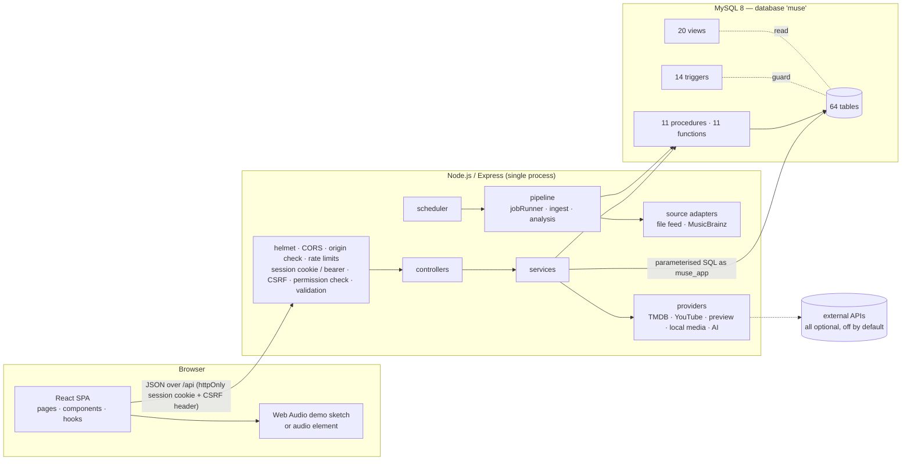
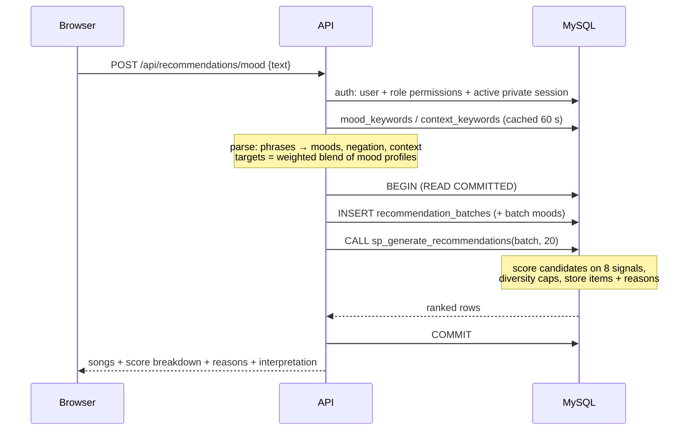
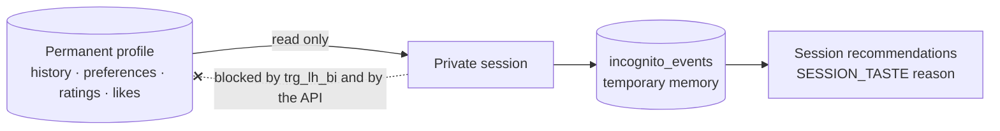
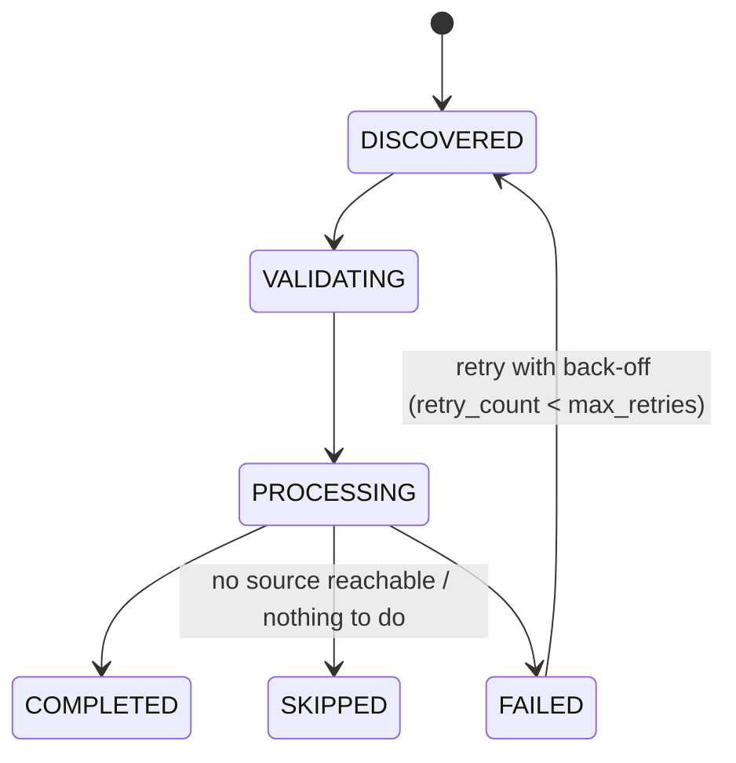
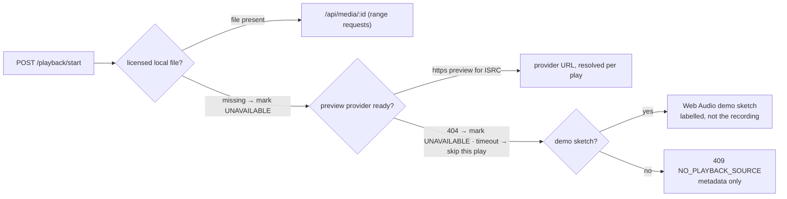

# Architecture

MUSE is a three-tier application in which the **database is the intelligence
tier**, not just storage. The API is deliberately thin: it validates input,
checks permissions, opens transactions and calls SQL. Scoring, learning,
mood tagging, merging, rollback and cleanup are stored procedures; integrity
rules that span rows are triggers; reporting is views and window functions.



## Layers

| Layer | Location | Responsibility |
|---|---|---|
| Presentation | `frontend/src` | React pages per screen; `services/api.js` is the only place that talks HTTP; `hooks/usePlayer.jsx` owns playback and sends start/events/finish |
| Routing & validation | `backend/src/routes/index.js`, `utils/validate.js` | Every route declares its body/query/params schema; unknown fields are dropped, invalid ones produce `400 VALIDATION_ERROR` with per-field details |
| AuthN / AuthZ | `middleware/auth.js`, `services/sessionService.js` | Looks up the server-side session by the SHA-256 of the presented token (cookie or bearer), checks CSRF for cookie writes, and **re-reads the session, user, role, permissions and active private session from the database on every request**, so logout, revocation, demotion, deactivation and private mode take effect immediately |
| Providers | `providers/*.js`, `services/providerService.js`, `services/mediaService.js` | One adapter per external service with a shared HTTP client (timeouts, retries, rate spacing, safe errors) and a status registry; the media service picks the playback source; the app never needs a provider to run |
| Readiness | `services/readinessService.js` | `/api/ready`: database, schema version vs the newest migration file, provider states |
| Controllers | `controllers/index.js` | Thin: pick validated input, call one service, choose the status code |
| Services | `services/*.js` | Business logic expressed as SQL; transactions through `withTransaction` |
| Pipeline | `services/pipeline/` | Job runner (idempotency, status machine, retries, logs), ingestion, analysis |
| Data access | `config/db.js` | `mysql2` pool as the least-privilege `muse_app` account; `query`, `one`, `call`, `withTransaction(fn, {isolation, retries, actorId})`, `asActor` |
| Errors | `middleware/errorHandler.js` | Maps MySQL errors (1062, 1451, 1452, 3819, 1644 SIGNAL, 1213…) to stable `{error:{code,message}}` responses; never sends SQL text or stack traces |

## A request, end to end: "I want something energetic"



The list is persisted before it is shown, so a later play can be linked to the
list and rank it came from (`listening_history.batch_id`), and "Why this song?"
is answered from stored numbers rather than recomputed.

## Listening → learning

`POST /playback/start` opens or reuses the user's listening session (idle > 30
minutes closes it) and inserts a `listening_history` row plus a `PLAY_STARTED`
event. `POST /playback/:id/finish` runs one transaction:

1. lock the user row (`SELECT … FOR UPDATE`) — the same lock order as the procedures;
2. store `listened_sec`; trigger `trg_lh_bu` derives `completion_pct`, `completed`, `skipped`;
3. add the final event, increment session counters atomically (`plays = plays + 1`);
4. `CALL sp_refresh_user_preferences_core(user)` — rebuild genre / artist / mood / context preferences with decay;
5. commit; return what was learned (the primary genre of the song with its new blended score and play count, shown as a toast such as "Finished: “Vennela Vaana”. Film Melody preference is now 82/100.").

## Private session



- Starting a private session first closes the open permanent session (so it is folded into the profile), then inserts `incognito_sessions` with an expiry (default 120 min).
- While it is active, plays write only `incognito_events`; ratings, likes, playlist edits, search logging and world generation are refused or skipped; the trigger `trg_lh_bi` rejects any permanent history insert, even from SQL.
- Ending deletes the session's events and private recommendation lists in one transaction; the minutely scheduler (`sp_cleanup_expired_incognito`) does the same for expired sessions.

## Pipeline and scheduler

All background work goes through `pipeline_jobs`, keyed by an `idempotency_key`
(UNIQUE), so re-running the same job for the same period is a no-op.



| When | Task |
|---|---|
| every minute | close idle listening sessions (`sp_close_listening_session`), expire and purge private sessions |
| every hour | purge sign-in sessions that ended > 30 days ago, re-check registered local media files, trend snapshot (`sp_generate_trend_snapshot`), weekly intelligence (runs once per week by key), retries |
| weekly (`WEEKLY_INTELLIGENCE`) | ingest enabled sources → analyse pending songs → refresh all preferences → trend snapshot → generate every listener's MUSE World |

Ingestion of one record: validate → canonicalise (sorted-key JSON, SHA-256 payload
hash, normalised title/artist) → match by ISRC / external id / normalised identity →
**created**, **linked**, **unchanged**, **review** (possible duplicate or suspicious
metadata) or **failed** (validation errors, logged with the record). Each outcome is a
`pipeline_job_logs` row and provenance in `source_records`.

Sources are rows in `music_sources` with a rights scope and a fallback chain:
MusicBrainz (metadata only, disabled by default) → partner file feed.

## Playback media



`v_song_playback` exposes the best permitted, not-unavailable source per song
(`ROW_NUMBER()` over `song_media` priority); `v_song_catalog` adds `playable`, and
`v_recommendation_candidates` contains playable songs only, so the recommender never
suggests a song that cannot be played.

## Migrations

`database/01–06` are the frozen 1.0 baseline. Every later change is a numbered file
in `database/migrations/` (`0001_sessions_and_accounts`, `0002_recommendation_and_world_feedback`,
`0003_playback_media_and_providers`), applied in order by `npm run db:migrate` and
recorded in `schema_migrations` with a SHA-256 checksum. A fresh install runs
baseline → seed → migrations, i.e. exactly the upgrade path; `npm run db:verify`
proves in a throw-away database that the upgraded structure equals a fresh install.

## Frontend structure

| Area | Files |
|---|---|
| App shell | `App.jsx` (routes, lazy admin), `components/Layout.jsx` (skip link, sidebar, mobile nav, top bar, offline banner, player bar with queue panel and volume, private toggle), `components/Intro.jsx` (first-visit introduction) |
| Listening | `pages/Home.jsx`, `Mood.jsx`, `Mix.jsx`, `World.jsx` (feedback), `Search.jsx`, `Catalog.jsx` (song / artist / album / film / language), `Library.jsx`, `Private.jsx`, `Settings.jsx` (account security, hidden songs, credits) |
| Insight | `pages/Profile.jsx` (profile, journey, preference model) with `components/Charts.jsx` (SVG charts with table fallbacks) |
| Admin | `pages/admin/*` — overview, catalogue and moods, pipeline and review queue, providers and media, models, users, health, performance lab, audit |
| State | `hooks/useAuth` (session check via `/auth/session`), `usePlayer` (play/finish events, queue, volume, real audio vs demo sketch), `useOnline`, `useToast`, `useApi` |

## Folder structure

```
muse/
├─ backend/
│  ├─ src/
│  │  ├─ app.js, server.js          Express app (exported for tests) and process entry
│  │  ├─ config/                    env.js (validated settings), db.js (pool, transactions)
│  │  ├─ middleware/                auth.js (sessions, CSRF, origin, RBAC), errorHandler.js
│  │  ├─ routes/, controllers/      route table with validation schemas; thin controllers
│  │  ├─ services/                  business logic as SQL; pipeline/ (jobs, ingest, analysis)
│  │  ├─ providers/                 external adapters + shared HTTP client + registry
│  │  ├─ sources/                   ingestion source adapters (file feed, MusicBrainz)
│  │  └─ utils/                     ApiError, validate, asyncHandler
│  ├─ scripts/                      setup-db, migrate, verify-db, seed and dictionary generators, demos
│  └─ tests/                        node:test API + database suites; tests/empty (empty catalogue)
├─ frontend/
│  └─ src/                          pages/, components/, hooks/, services/api.js, lib/, styles/ (+ *.test.jsx)
├─ database/
│  ├─ 01–06_*.sql                   frozen baseline: schema, functions, views, procedures, triggers, grants
│  ├─ 07_seed.sql                   generated demo data (fictional catalogue)
│  ├─ 08_queries.sql                SQL collection (npm run test:sql)
│  ├─ migrations/                   0001…: versioned schema changes
│  └─ sources/                      partner feed fixture for the ingestion pipeline
├─ e2e/                             Playwright (Python) browser checks + axe accessibility scan
├─ media/                           your licensed audio files (git-ignored)
└─ docs/                            this documentation
```

Design system: indigo base (`#0F1322`), marigold accent (`#F2B544`), Fraunces for
display type and Hanken Grotesk for text, both self-hosted (the CSP allows only
`'self'`). The one decorative element is the generative MUSE World artwork, drawn
from the world's stored `theme` (palette, motif, seed).
