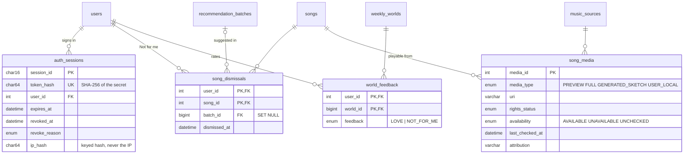

# Database design

MySQL 8.0 · InnoDB · `utf8mb4` · 64 tables, 20 views, 11 procedures, 11 functions,
14 triggers, 71 CHECK constraints, 124 foreign keys, 222 indexes (schema version
0004: the 1.0 baseline plus four migrations, section 7).
Column-level detail for every table is in [DATA_DICTIONARY.md](DATA_DICTIONARY.md).

## 1. Requirements the schema has to carry

| Requirement | Where it lives |
|---|---|
| A catalogue with stable identity even when sources disagree | `songs` (surrogate key + `UNIQUE(primary_artist_id, normalized_title, version_label)` + `UNIQUE(isrc)`), `artist_aliases`, `source_records`, `songs.merged_into_song_id` |
| Mood and audio analysis that can be re-run by newer models without losing the old results | `intelligence_models`, `model_parameters`, `audio_features` (one row per song per model, exactly one current), `song_moods` (per model), `mood_segments`, `song_mood_curations` |
| Behaviour that is append-only and trustworthy | `listening_sessions` → `listening_history` → `playback_events`; derived flags set by triggers; history immutable |
| Explicit feedback | `ratings` (PK user+song, 1–5), `user_likes`, `song_mood_ratings` (PK user+song+mood, 0–100 % per mood; separate from the AI's `song_moods`) |
| Learned taste that can be rebuilt | `user_genre/artist/mood/context_preferences` (derived, recomputed by a procedure) |
| Recommendations that can be explained later | `recommendation_batches` → `recommendation_items` (all signal scores) → `recommendation_reasons` (normalised `reason_types` + JSON params) |
| Private sessions isolated from the permanent profile | `incognito_sessions`, `incognito_events`, trigger `trg_lh_bi` |
| Weekly worlds with versioning and rollback | `world_archetypes`, `archetype_moods`, `weekly_worlds` (one ACTIVE per user-week) |
| Pipeline with idempotency and provenance | `music_sources`, `song_media`, `pipeline_jobs` (UNIQUE idempotency key), `source_records`, `pipeline_job_logs`, `review_queue` |
| Access control and accountability | `roles`, `permissions`, `role_permissions`, `audit_logs` (append-only for the app account) |

## 2. ER diagram (core entities)

> Generated, validated diagrams of the **complete final schema** (all 64 tables and 124 foreign keys) are in [`docs/erd/`](erd/MUSE_ERD_EXPLANATION.md). The hand-drawn overview below predates migrations 0001–0003; six of its cardinalities show "one or more" / a mandatory 1:1 where the foreign keys enforce "zero or more" / "zero or one" (listed in the ERD validation report).

Relationship tables and lookup tables are included where they carry meaning.
Cardinalities are crow's-foot: `||` exactly one, `o|` zero or one, `}o` zero or many, `}|` one or many.

```mermaid
erDiagram
  ROLES ||--o{ USERS : has
  ROLES ||--|{ ROLE_PERMISSIONS : grants
  PERMISSIONS ||--o{ ROLE_PERMISSIONS : "granted by"
  USERS ||--|| USER_PROFILES : "has profile"
  REGIONS |o--o{ USER_PROFILES : "lives in"
  USERS ||--o{ USER_LANGUAGES : prefers
  LANGUAGES ||--o{ USER_LANGUAGES : ""

  ARTISTS ||--o{ ARTIST_ALIASES : "also known as"
  ARTISTS ||--o{ SONGS : "primary credit"
  ALBUMS |o--o{ SONGS : contains
  ALBUMS ||--|{ ALBUM_ARTISTS : ""
  FILMS |o--o{ ALBUMS : soundtrack
  SONGS ||--|{ SONG_GENRES : ""
  GENRES ||--o{ SONG_GENRES : ""
  GENRES |o--o{ GENRES : "parent of"
  LANGUAGES |o--o{ SONGS : "sung in"

  INTELLIGENCE_MODELS ||--o{ MODEL_PARAMETERS : tuned by
  SONGS ||--o{ AUDIO_FEATURES : "analysed (versions)"
  INTELLIGENCE_MODELS ||--o{ AUDIO_FEATURES : produced
  SONGS ||--o{ SONG_MOODS : tagged
  MOODS ||--o{ SONG_MOODS : ""
  INTELLIGENCE_MODELS ||--o{ SONG_MOODS : produced
  SONGS ||--o{ MOOD_SEGMENTS : "time-coded"
  SONGS ||--o{ SONG_MOOD_CURATIONS : "curator override"
  MOOD_CATEGORIES ||--o{ MOODS : groups
  MOODS ||--o{ MOOD_KEYWORDS : "phrases"
  CONTEXTS ||--o{ CONTEXT_MOODS : ""

  USERS ||--o{ LISTENING_SESSIONS : opens
  LISTENING_SESSIONS ||--o{ LISTENING_HISTORY : contains
  SONGS ||--o{ LISTENING_HISTORY : played
  LISTENING_HISTORY ||--o{ PLAYBACK_EVENTS : emits
  USERS ||--o{ RATINGS : rates
  SONGS ||--o{ RATINGS : ""
  USERS ||--o{ USER_LIKES : likes
  USERS ||--o{ PLAYLISTS : owns
  PLAYLISTS ||--o{ PLAYLIST_SONGS : ""
  SONGS ||--o{ PLAYLIST_SONGS : ""

  USERS ||--o{ RECOMMENDATION_BATCHES : receives
  RECOMMENDATION_BATCHES ||--|{ RECOMMENDATION_ITEMS : ranks
  RECOMMENDATION_ITEMS ||--|{ RECOMMENDATION_REASONS : "explained by"
  REASON_TYPES ||--o{ RECOMMENDATION_REASONS : ""
  RECOMMENDATION_BATCHES |o--o{ LISTENING_HISTORY : "led to"

  USERS ||--o{ USER_GENRE_PREFERENCES : learned
  USERS ||--o{ USER_MOOD_PREFERENCES : learned
  USERS ||--o{ INCOGNITO_SESSIONS : "goes private"
  INCOGNITO_SESSIONS ||--o{ INCOGNITO_EVENTS : "temporary memory"
  USERS ||--o{ WEEKLY_WORLDS : "gets weekly"
  WORLD_ARCHETYPES ||--o{ WEEKLY_WORLDS : themes
  RECOMMENDATION_BATCHES ||--o| WEEKLY_WORLDS : "song list"

  MUSIC_SOURCES ||--o{ SOURCE_RECORDS : provides
  SONGS |o--o{ SOURCE_RECORDS : "provenance of"
  PIPELINE_JOBS ||--o{ PIPELINE_JOB_LOGS : logs
  PIPELINE_JOBS ||--o{ TREND_SNAPSHOTS : computes
  SOURCE_RECORDS |o--o{ REVIEW_QUEUE : "needs review"
  MUSIC_SOURCES ||--o{ SONG_MEDIA : "permitted playback"
  USERS |o--o{ AUDIT_LOGS : "acted"
```

### Table groups

| # | Group | Tables |
|---|---|---|
| 1 | Reference | `languages`, `regions` |
| 2 | Identity & access | `roles`, `permissions`, `role_permissions`, `users`, `user_profiles`, `user_languages` |
| 3 | Catalogue | `genres` (self-referencing hierarchy), `artists`, `artist_aliases`, `films`, `albums`, `album_artists`, `songs`, `song_artists`, `song_genres` |
| 4 | Versioned intelligence | `intelligence_models`, `model_parameters`, `audio_features`, `mood_categories`, `moods`, `song_moods`, `mood_segments`, `song_mood_curations`, `mood_keywords` |
| 5 | Contexts | `contexts`, `context_moods`, `context_keywords` |
| 6 | Sources & pipeline | `music_sources`, `song_media`, `pipeline_jobs`, `source_records`, `pipeline_job_logs`, `review_queue` |
| 7 | Listening | `listening_sessions`, `listening_history`, `playback_events`, `search_history` |
| 8 | Feedback | `ratings`, `user_likes` |
| 9 | Recommendations | `recommendation_batches`, `recommendation_batch_moods`, `recommendation_items`, `reason_types`, `recommendation_reasons` |
| 10 | Learned preferences | `user_genre_preferences`, `user_artist_preferences`, `user_mood_preferences`, `user_context_preferences` |
| 11 | Private sessions | `incognito_sessions`, `incognito_events` |
| 12 | MUSE World | `world_archetypes`, `archetype_moods`, `weekly_worlds` |
| 13 | Trends | `trend_snapshots` |
| 14 | Playlists | `playlists`, `playlist_songs` |
| 15 | Audit | `audit_logs` |

## 3. Normalisation

### Starting point (UNF)

Imagine the data as one flat "listening sheet", which is how a naive system would log it:

| user | email | region | region_name | languages | song | artist | artist_country | album | genres | moods (confidence) | energy | tempo | played_at | listened | duration | rating |
|---|---|---|---|---|---|---|---|---|---|---|---|---|---|---|---|---|
| aarav | aarav@muse.dev | IN-TG | Telangana | te, hi | Vennela Vaana | Varsha Kondapalli | IN | Vennela Vaana | Film Melody, Indian Film | Romantic 0.94, Relaxed 0.84, Nostalgic 0.70 | 0.43 | 93 | 2026-10-03 21:10 | 221 | 228 | 5 |

Problems: repeating groups (`languages`, `genres`, `moods`), the same song facts repeated on every play (update anomaly), you cannot add a song nobody has played (insertion anomaly), deleting a user's last play loses the song (deletion anomaly).

### 1NF — atomic values, no repeating groups

Each multi-valued attribute becomes its own relation keyed by the owner plus the value:
`user_languages(user_id, language_id, priority)`, `song_genres(song_id, genre_id, is_primary)`,
`song_moods(song_id, mood_id, model_id, confidence)`. Every cell now holds one value;
every play is one row of `listening_history`.

### 2NF — no partial dependency on a composite key

Candidate key of the flat play relation after 1NF: `(user, song, played_at)`.
Partial dependencies found:

- `song → title, artist, album, duration, release_year …` (depends on `song` only)
- `user → email, region, display_name …` (depends on `user` only)
- `(user, song) → rating` (does not depend on `played_at`)

So: `songs(song_id …)`, `users(user_id …)` / `user_profiles(user_id …)`, `ratings(user_id, song_id, rating)` with PK `(user_id, song_id)`, and `listening_history(play_id, user_id, song_id, started_at, listened_sec …)`.
The same check applies to every M:N table: in `song_moods` the non-key attribute `confidence` depends on the whole key `(song_id, mood_id, model_id)`.

### 3NF — no transitive dependency

| Transitive dependency | Resolution |
|---|---|
| `song → artist → artist_country, artist_region` | `artists(artist_id, name, country_code, region_code …)`; songs keep only `primary_artist_id` |
| `user_profile → region_code → region_name, state` | `regions(region_code, name, …)` |
| `song → album → album_type, film, cover colours` | `albums(album_id …)`, `films(film_id …)` |
| `song → (current) audio analysis → energy, tempo …` | `audio_features(feature_id, song_id, model_id, …)` |
| `mood → category → category_name` | `mood_categories` |
| `recommendation reason text → template` | `reason_types(reason_code, template)`; each stored reason keeps only `reason_code` + JSON params |

### BCNF

For each table every non-trivial functional dependency has a superkey on the left. Notable checks:

- `songs`: `song_id → *` and `(primary_artist_id, normalized_title, version_label) → song_id` (declared UNIQUE, so it is a candidate key, not a violation); `isrc → song_id` (UNIQUE). Both determinants are candidate keys.
- `audio_features`: `feature_id → *`; `(song_id, model_id) → feature_id` (UNIQUE). "Which row is current" is a rule, not a dependency: it is enforced by the VIRTUAL column `current_song_key` + UNIQUE.
- `user_profiles`: `user_id → *` (1:1 split from `users` keeps credentials apart from profile data).
- `weekly_worlds`: `world_id → *`; `(user_id, week_start, version) → world_id` (UNIQUE); `batch_id → world_id` (UNIQUE).

### Controlled redundancy (deliberate, guarded)

| Redundant data | Why | What keeps it correct |
|---|---|---|
| `songs.normalized_title`, `artists.normalized_name`, `albums.normalized_title` | duplicate detection and indexed matching | **STORED generated columns** — cannot drift |
| `listening_history.completion_pct`, `completed`, `skipped`, `is_replay` | read on every profile / trend / preference query | set by triggers `trg_lh_bi` / `trg_lh_bu` from `listened_sec` and the song's duration; the client cannot send them |
| `playlists.song_count`, `total_duration_sec` | shown on every playlist card | maintained by `trg_ps_ai` / `trg_ps_ad`; health check compares them with `playlist_songs` |
| `listening_sessions.plays`, `listen_sec` | session summaries | atomic `UPDATE … SET plays = plays + 1`; recomputed exactly by `sp_close_listening_session` |
| `user_*_preferences` | the recommender reads them on every request | fully derived; `sp_refresh_user_preferences` rebuilds them from history at any time and stamps `model_id`, `computed_at` |
| `trend_snapshots` | trends are read far more often than computed | an append-only fact table per job; old snapshots remain for comparison |

## 4. Keys and constraint patterns

- **Surrogate keys** (`AUTO_INCREMENT`) for entities whose natural identity is unstable (songs get renamed, artists merged). **Natural keys** where identity is stable: `region_code`, `permission_code`, `reason_code`, `archetype_code`.
- **Composite keys** for relationships (`ratings(user_id, song_id)`, `playlist_songs(playlist_id, song_id)`) — a second rating or the same song twice in a playlist is impossible by construction.
- **Composite foreign key** `listening_history(session_id, user_id) → listening_sessions(session_id, user_id)`: a play can only belong to a session of the same user.
- **"Exactly one current/active" rules** use a VIRTUAL generated column that equals the key when the row is current and NULL otherwise, plus a UNIQUE index (UNIQUE ignores NULLs):

  | Rule | Column |
  |---|---|
  | one current audio analysis per song | `audio_features.current_song_key` |
  | one primary genre per song | `song_genres.primary_song_key` |
  | one active model per kind | `intelligence_models.active_kind` |
  | one active private session per user | `incognito_sessions.active_user_key` |
  | one active world per user-week | `weekly_worlds.active_key` |
  | one pending review per record and type | `review_queue.pending_key` |

- **CHECK constraints (66)** for ranges and cross-column rules, e.g. audio features in [0, 1], tempo 40–220 BPM, `explicit = 0 OR content_rating <> 'ALL'`, `(status = 'MERGED') = (merged_into_song_id IS NOT NULL)`, `NOT (completed AND skipped)`, session state consistency, valid ISRC pattern, email shape.
- **ON DELETE** stated on every FK: `CASCADE` for owned children (a user's sessions, a playlist's songs), `RESTRICT` where history must survive (an artist with songs, a model with outputs), `SET NULL` for optional links (a play's source list, a song's album).

## 5. Programmable objects

### Stored procedures (11)

| Procedure | Purpose | Transaction |
|---|---|---|
| `sp_generate_recommendations(batch, limit)` | the recommendation engine: 8-signal scoring, repetition penalty, diversity caps, stores items and reasons | building block, runs inside the caller's transaction |
| `sp_refresh_user_preferences_core(user)` / `sp_refresh_user_preferences(user)` | rebuild learned preferences with time decay and cold-start blending | core: caller's tx; wrapper: own tx with user row lock |
| `sp_analyze_song_moods(model, feature_model, song)` | rule-based mood tagging from audio features, then re-apply curator decisions | caller's tx |
| `sp_set_current_audio_features(feature)` | switch the current analysis version (old row first, so the unique key never sees two) | caller's tx |
| `sp_close_listening_session(session)` | recompute exact counters, close, refresh preferences | own tx |
| `sp_generate_trend_snapshot(job)` | 24H / 7D / 30D windows × songs, artists, genres, moods, languages × all / per region; velocity and momentum rank | own tx |
| `sp_cleanup_expired_incognito()` | expire private sessions and delete their temporary data | own tx |
| `sp_rollback_world(user, week)` | re-activate the previous world version | own tx, `FOR UPDATE` |
| `sp_merge_songs(dup, canonical, actor)` | move history, ratings, likes, playlist entries, provenance; mark MERGED | own tx, row locks, audited |
| `sp_user_listening_summary(user, days)` | profile report, several result sets | read-only |

Procedures that own a transaction declare `EXIT HANDLER FOR SQLEXCEPTION BEGIN ROLLBACK; RESIGNAL; END` and validate input with `SIGNAL SQLSTATE '45000'`; the API maps those messages to 4xx responses.

### Functions (11)

`fn_normalize_text`, `fn_completion_pct`, `fn_decay(age, half_life)` = 0.5^(age/half_life), `fn_unit_similarity`, `fn_feature_similarity` (1 − weighted Euclidean distance over energy and valence ×1.6, danceability, acousticness and instrumentalness ×0.6), `fn_tempo_fit`, `fn_mood_fit` (song features vs a mood's profile), `fn_nearest_mood`, `fn_week_start` (Monday), `fn_model_param`, `fn_active_model`.

### Triggers (14) — used for three jobs only

| Job | Triggers |
|---|---|
| Integrity a CHECK cannot express | `trg_lh_bi` (private-session isolation, playable song, listened ≤ duration), `trg_lh_bu` (history immutable except via merge), `trg_ie_bi` (events only into a live private session), `trg_ms_bi` / `trg_ms_bu` (segments inside the song, no overlap) |
| Derived columns | `trg_lh_bi` / `trg_lh_bu` (completion %, completed, skipped, replay), `trg_ps_bi` (position), `trg_ps_ai` / `trg_ps_ad` (playlist count and length) |
| Audit | `trg_songs_au_audit`, `trg_songs_ad_audit`, `trg_users_au_audit`, `trg_mp_au_audit`, `trg_review_au_audit`, `trg_sources_au_audit` — the actor comes from the session variable `@muse_actor_id`, set by the API for the duration of an admin transaction |

Preference learning is deliberately **not** a trigger: it needs decay and normalisation over all of a user's rows, must be re-runnable, and is versioned by model.

### Views (19)

| View | Used by |
|---|---|
| `v_current_audio_features`, `v_current_song_moods`, `v_song_primary_mood` | everything that needs "the current analysis" without knowing about versions |
| `v_song_catalog` | song cards (one row with artist, album, film, genre, language, features, moods, playback source and `playable`) |
| `v_song_playback` | the best permitted, available playback source per song (`ROW_NUMBER()` over priority); no row = metadata only |
| `v_recommendation_candidates` | the engine's eligibility rule in one place (active, analysed, has a primary genre, **playable**) |
| `v_song_stats`, `v_artist_popularity`, `v_genre_statistics` | catalogue and admin statistics |
| `v_user_music_profile`, `v_daily_listening_summary`, `v_weekly_mood_summary` | Listening Profile and Mood Journey (window functions inside) |
| `v_recommendation_explanations` | reasons rendered into sentences from stored params |
| `v_latest_trends`, `v_trending_songs` | trending lists |
| `v_muse_world_summary` | World page and admin |
| `v_incognito_memory` | the temporary taste of an active private session |
| `v_data_quality` | provenance and quality per source |
| `v_user_permissions` | the access matrix as data (Q35) |

## 6. SQL concept coverage (database/08_queries.sql)

| Concept | Queries |
|---|---|
| Inner / multi-table joins, GROUP BY, HAVING | Q02, Q03, Q05, Q08, Q22 |
| LEFT / RIGHT JOIN, COALESCE | Q13, Q14 |
| Subqueries: correlated, EXISTS / NOT EXISTS, in HAVING | Q06, Q12, Q21, Q26, Q31 |
| CTEs and recursive CTEs | Q01, Q07, Q11, Q15 (genre tree), Q17 (calendar) |
| Window functions: ROW_NUMBER, RANK, DENSE_RANK, PERCENT_RANK, NTILE, LAG, LEAD, moving average | Q01, Q16, Q17, Q18, Q19, Q20, Q23, Q30 |
| Gaps-and-islands | Q16 (listening streaks) |
| Pivot via conditional aggregation | Q25, Q35, Q39 |
| Migrations, sessions, playback availability, feedback tables | Q36–Q40 |
| FULLTEXT search, UNION ALL | Q24 |
| Versioned data comparison | Q27 |
| Views, procedures, JSON aggregation | Q29, Q30, Q32, Q33, Q34 |
| Transactions COMMIT / ROLLBACK | T1, T2, T3 |
| EXPLAIN with and without indexes | E1–E4 (more in [PERFORMANCE.md](PERFORMANCE.md)) |

All 47 blocks run as the least-privilege app account: `npm run test:sql`.

## 7. Migrations after 1.0

The baseline files `01–06` are frozen. Each later change is a numbered, re-runnable
file in `database/migrations/`, recorded in `schema_migrations` (version, name,
SHA-256 checksum, applied_at, execution_ms). `npm run db:status` lists applied and
pending files; an applied file that was edited afterwards is refused.

| Migration | Changes | Design notes |
|---|---|---|
| `0001_sessions_and_accounts` | `auth_sessions`; `users.password_changed_at`; the missing FK `song_mood_curations.curated_by → users` (SET NULL) | Sessions are their own entity (a user has many); the secret is stored only as a hash; `CHECK ((revoked_at IS NULL) = (revoke_reason IS NULL))` and `expires_at > created_at`; index `(user_id, revoked_at, expires_at)` serves "live sessions of a user"; `ON DELETE CASCADE` removes sessions with the account |
| `0002_recommendation_and_world_feedback` | `song_dismissals`, `world_feedback`; WORLD model parameters `feedback_love_boost`, `feedback_dismiss_penalty`, `feedback_weeks`; `sp_generate_recommendations` skips dismissed songs; `sp_merge_songs` moves dismissals | Both tables have a composite natural key (one dismissal per user and song, one feedback per user and world), so they are in BCNF with no surrogate key; the batch link is optional history (`SET NULL`) |
| `0003_playback_media_and_providers` | `song_media.availability`, `last_checked_at`, `attribution`, index `(song_id, availability)`; source type `VIDEO_METADATA`; sources `YOUTUBE_DATA`, `LOCAL_MEDIA`, `EXTERNAL_PREVIEW`; demo sketch renamed "Demo sketch (local fixture)"; views `v_song_playback`, `v_song_catalog` (+ film id, playback), `v_recommendation_candidates` (playable only) | Availability is a property of one media row (not of the song), so a song can have a working sketch and an unavailable preview at the same time; "playable" is derived in a view, never stored |
| `0004_song_mood_ratings` | `song_mood_ratings` (PK `(user_id, song_id, mood_id)`, `match_percentage DECIMAL(5,2)` with `CHECK 0–100`, optional `review_text`, timestamps; FKs to users, songs, moods ON DELETE CASCADE; indexes `(song_id, mood_id, match_percentage)` and `(mood_id, song_id, match_percentage)`); view `v_song_mood_rating_stats` (count, average, min, max per song and mood); `sp_merge_songs` carries mood ratings to the canonical song (newer rating wins) | A ternary associative entity User–Song–Mood in BCNF; averages are computed in a view, never stored. User opinion is kept apart from the AI's `song_moods.confidence`, which it never overwrites. Details: [MOOD_RATINGS.md](MOOD_RATINGS.md) |

Normalisation of the new tables: every non-key attribute depends on the whole key
and nothing else (`auth_sessions`: all attributes depend on `session_id`;
`token_hash` is a candidate key; `song_dismissals` and `world_feedback`: the
timestamps and feedback depend on the full composite key). No derived value is
stored except the deliberate `playable` view column.

The demo seed has six **metadata-only** songs (every 17th song id has no media row),
so the difference between "in the catalogue" and "playable" is visible.

### Working with MySQL Workbench

1. **Connect**: Database › Manage Connections › New: host `127.0.0.1`, port `3306`, user `muse_owner` (to change the schema) or `muse_app` (to see exactly what the API can do).
2. **ER diagram**: Database › Reverse Engineer… › pick schema `muse` › Execute. Workbench draws all 64 tables with their foreign keys. Arrange by the table groups above.
3. **Run the SQL collection**: File › Open SQL Script › `database/08_queries.sql`, then run block by block (each starts with `-- Qnn:`). Use `muse_app` to prove the queries need no extra privileges.
4. **Inspect routines and triggers**: in the navigator, expand `muse` › Stored Procedures / Functions / Tables › *table* › Triggers.
5. **EXPLAIN**: select a query and press *Explain Current Statement* (or run the `E1–E4` blocks) to see the visual plan.
6. **Do not** apply schema changes from Workbench directly: add a migration file and run `npm run db:migrate`, so every database follows the same history.
