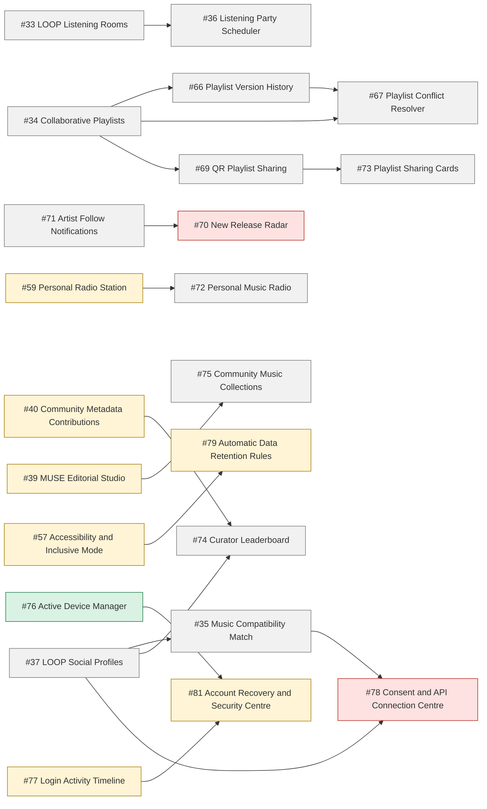

# Feature dependency map

*Developed by Vaishnav Sai.* Generated by `backend/scripts/roadmap/build-roadmap-docs.js` from `feature-registry.json`.
An arrow A → B means B needs A first: either B lists A in `dependsOn`, or B uses a table / column that A's migration creates.

17 dependencies between 23 features; the other 64 features stand alone on the existing schema.

## Graph

Colours: green VERIFIED · blue IMPLEMENTED-UNVERIFIED · amber PARTIAL · grey PLANNED · red BLOCKED · dashed NOT IMPLEMENTED.

## Foundations (most other features build on these)

| # | Feature | Status | Needed by |
| --- | --- | --- | --- |
| 34 | Collaborative Playlists | PLANNED | #66, #67, #69 |
| 37 | LOOP Social Profiles | PLANNED | #35, #74, #78 |
| 33 | LOOP Listening Rooms | PLANNED | #36 |
| 35 | Music Compatibility Match | PLANNED | #78 |
| 39 | MUSE Editorial Studio | PARTIAL | #75 |
| 40 | Community Metadata Contributions | PARTIAL | #74 |
| 57 | Accessibility and Inclusive Mode | PARTIAL | #79 |
| 59 | Personal Radio Station | PARTIAL | #72 |
| 66 | Playlist Version History | PLANNED | #67 |
| 69 | QR Playlist Sharing | PLANNED | #73 |
| 71 | Artist Follow Notifications | PLANNED | #70 |
| 76 | Active Device Manager | VERIFIED | #81 |
| 77 | Login Activity Timeline | PARTIAL | #81 |

## Every feature

| # | Feature | Dependency | Status | Needs first | Needed by |
| --- | --- | --- | --- | --- | --- |
| 1 | Multi-Mood Blending | CORE | IMPLEMENTED-UNVERIFIED | — | — |
| 2 | Mood Journey Engine | CORE | IMPLEMENTED-UNVERIFIED | — | — |
| 3 | Context-Aware Recommendations | CORE | VERIFIED | — | — |
| 4 | Why This Song? | CORE | VERIFIED | — | — |
| 5 | Skip-Aware Learning | CORE | PARTIAL | — | — |
| 6 | Recommendation Diversity | CORE | IMPLEMENTED-UNVERIFIED | — | — |
| 7 | Smart Cold Start | CORE | VERIFIED | — | — |
| 8 | Recommendation Confidence | CORE | IMPLEMENTED-UNVERIFIED | — | — |
| 9 | Mood Dial | CORE | IMPLEMENTED-UNVERIFIED | — | — |
| 10 | Multilingual Search Intelligence | CORE | PARTIAL | — | — |
| 11 | Cross-Device Continuity | CORE | PARTIAL | — | — |
| 12 | Interactive ER Explorer | CORE | IMPLEMENTED-UNVERIFIED | — | — |
| 13 | Mood Diary | CORE | IMPLEMENTED-UNVERIFIED | — | — |
| 14 | One-Tap Listening Modes | CORE | VERIFIED | — | — |
| 15 | Surprise Me | CORE | IMPLEMENTED-UNVERIFIED | — | — |
| 16 | Human vs Model Comparison | CORE | VERIFIED | — | — |
| 17 | Save My Mood Mix | CORE | PARTIAL | — | — |
| 18 | Personal Music Wrapped | CORE | PARTIAL | — | — |
| 19 | Taste Evolution Timeline | CORE | PARTIAL | — | — |
| 20 | Mood Calendar Heatmap | CORE | IMPLEMENTED-UNVERIFIED | — | — |
| 21 | Skip Pattern Intelligence | CORE | IMPLEMENTED-UNVERIFIED | — | — |
| 22 | Artist Discovery Graph | CORE | NOT IMPLEMENTED | — | — |
| 23 | Personal Recommendation Controls | CORE | PARTIAL | — | — |
| 24 | Privacy Control Centre | CORE | PARTIAL | — | — |
| 25 | SQL Query Studio | CORE | PARTIAL | — | — |
| 26 | SQL Execution Plan Visualizer | CORE | PARTIAL | — | — |
| 27 | Index Performance Lab | INFRA | NOT IMPLEMENTED | — | — |
| 28 | Transaction Demonstrator | CORE | PARTIAL | — | — |
| 29 | Permission Matrix | CORE | PARTIAL | — | — |
| 30 | Data Quality Centre | CORE | PARTIAL | — | — |
| 31 | Database Scenario Simulator | CORE | PARTIAL | — | — |
| 32 | Mood Disagreement Analysis | CORE | PARTIAL | — | — |
| 33 | LOOP Listening Rooms | INFRA | PLANNED | — | #36 |
| 34 | Collaborative Playlists | CORE | PLANNED | — | #66, #67, #69 |
| 35 | Music Compatibility Match | CORE | PLANNED | #37 | #78 |
| 36 | Listening Party Scheduler | INFRA | PLANNED | #33 | — |
| 37 | LOOP Social Profiles | CORE | PLANNED | — | #35, #74, #78 |
| 38 | Playlist Notes and Reactions | CORE | PLANNED | — | — |
| 39 | MUSE Editorial Studio | CORE | PARTIAL | — | #75 |
| 40 | Community Metadata Contributions | CORE | PARTIAL | — | #74 |
| 41 | Music Data Provenance | CORE | VERIFIED | — | — |
| 42 | Smart Duplicate Song Detection | CORE | IMPLEMENTED-UNVERIFIED | — | — |
| 43 | Lyrics Intelligence and Search | PROVIDER | BLOCKED | — | — |
| 44 | Time-Synchronized Lyrics | PROVIDER | BLOCKED | — | — |
| 45 | Song Mood Timeline | CORE | VERIFIED | — | — |
| 46 | Audio Fingerprint Intelligence | PROVIDER | BLOCKED | — | — |
| 47 | Intelligent Song Transitions | PLATFORM | PLANNED | — | — |
| 48 | BPM and Harmonic Matching | CORE | PARTIAL | — | — |
| 49 | Time-Budget Playlist Generator | CORE | PLANNED | — | — |
| 50 | Music Discovery Missions | CORE | PLANNED | — | — |
| 51 | Music Discovery Passport | CORE | PLANNED | — | — |
| 52 | Music Time Capsule | CORE | PLANNED | — | — |
| 53 | Seasonal and Occasion Mixes | CORE | PLANNED | — | — |
| 54 | Mood-Based Music Alarm | PLATFORM | BLOCKED | — | — |
| 55 | Personal Listening Profile | CORE | VERIFIED | — | — |
| 56 | Voice-Controlled LOOP | PLATFORM | PLANNED | — | — |
| 57 | Accessibility and Inclusive Mode | CORE | PARTIAL | — | #79 |
| 58 | Smart Queue Autopilot | CORE | PARTIAL | — | — |
| 59 | Personal Radio Station | CORE | PARTIAL | — | #72 |
| 60 | Sleep Timer with Audio Fade | CORE | IMPLEMENTED-UNVERIFIED | — | — |
| 61 | Focus Timer + Music | CORE | PLANNED | — | — |
| 62 | Playback Quality Selector | PROVIDER | BLOCKED | — | — |
| 63 | Listening Session Bookmarks | CORE | PLANNED | — | — |
| 64 | Playlist Health Score | CORE | PLANNED | — | — |
| 65 | Duplicate Playlist Cleaner | CORE | PARTIAL | — | — |
| 66 | Playlist Version History | CORE | PLANNED | #34 | #67 |
| 67 | Playlist Conflict Resolver | CORE | PLANNED | #34, #66 | — |
| 68 | Playlist Alternative Finder | CORE | PLANNED | — | — |
| 69 | QR Playlist Sharing | CORE | PLANNED | #34 | #73 |
| 70 | New Release Radar | PROVIDER | BLOCKED | #71 | — |
| 71 | Artist Follow Notifications | CORE | PLANNED | — | #70 |
| 72 | Personal Music Radio | CORE | PLANNED | #59 | — |
| 73 | Playlist Sharing Cards | CORE | PLANNED | #69 | — |
| 74 | Curator Leaderboard | CORE | PLANNED | #37, #40 | — |
| 75 | Community Music Collections | CORE | PLANNED | #39 | — |
| 76 | Active Device Manager | CORE | VERIFIED | — | #81 |
| 77 | Login Activity Timeline | CORE | PARTIAL | — | #81 |
| 78 | Consent and API Connection Centre | PROVIDER | BLOCKED | #35, #37 | — |
| 79 | Automatic Data Retention Rules | CORE | PARTIAL | #57 | — |
| 80 | Personal Data Export | CORE | IMPLEMENTED-UNVERIFIED | — | — |
| 81 | Account Recovery and Security Centre | PROVIDER | PARTIAL | #76, #77 | — |
| 82 | Database Backup and Restore Centre | INFRA | PLANNED | — | — |
| 83 | Migration History Dashboard | CORE | PARTIAL | — | — |
| 84 | API Health Monitor | CORE | PARTIAL | — | — |
| 85 | Recommendation A/B Testing | CORE | PLANNED | — | — |
| 86 | Feature Flag Manager | CORE | PLANNED | — | — |
| 87 | Load and Performance Lab | INFRA | PARTIAL | — | — |

## External blockers

| # | Feature | Type | What is needed |
| --- | --- | --- | --- |
| 33 | LOOP Listening Rooms | INFRA | A real-time channel (SSE or WebSocket) and its hosting; Synchronised playback is limited to songs with a permitted audio source; metadata-only songs cannot be played together |
| 36 | Listening Party Scheduler | INFRA | Reminders need web push (PLATFORM: not available on every browser) or email (PROVIDER); in-app reminders work without either |
| 43 | Lyrics Intelligence and Search | PROVIDER | A licensed lyrics provider and its terms (PROVIDER) |
| 44 | Time-Synchronized Lyrics | PROVIDER | A provider that licenses timed lyrics (PROVIDER); A permitted, full-length audio source; previews and the demo sketch do not match lyric timing |
| 46 | Audio Fingerprint Intelligence | PROVIDER | Audio files we are licensed to analyse, or a fingerprint service and its key (PROVIDER) |
| 47 | Intelligent Song Transitions | PLATFORM | Crossfade needs two permitted audio sources playing at once (Web Audio API); metadata-only songs cannot crossfade |
| 52 | Music Time Capsule | CORE | An unlock reminder outside the app needs web push or email; the app shows unlocked capsules on next visit without them |
| 53 | Seasonal and Occasion Mixes | CORE | Curators must enter real dates per year; no dates are invented |
| 54 | Mood-Based Music Alarm | PLATFORM | Browsers and installed PWAs cannot reliably wake a device or start audio at a set time when the app is closed (PLATFORM). Needs native packaging (e.g. Capacitor) with OS alarm/notification APIs. |
| 56 | Voice-Controlled LOOP | PLATFORM | Speech recognition availability varies by browser and OS (PLATFORM) |
| 62 | Playback Quality Selector | PROVIDER | A licensed audio source offering multiple bitrates (local licensed files are single-rendition today) |
| 70 | New Release Radar | PROVIDER | A licensed release-metadata feed with release dates (provider adapter, credentials in .env) |
| 78 | Consent and API Connection Centre | PROVIDER | OAuth client registration with at least one provider; provider terms allowing per-user connections |
| 81 | Account Recovery and Security Centre | PROVIDER | A transactional e-mail provider (credentials in .env, never in code) for recovery links |
| 82 | Database Backup and Restore Centre | INFRA | Server-side mysqldump/xtrabackup and encrypted storage location |
